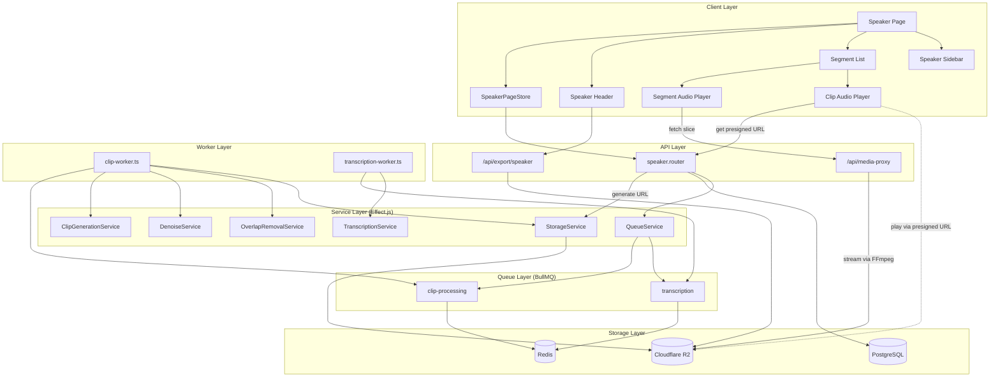
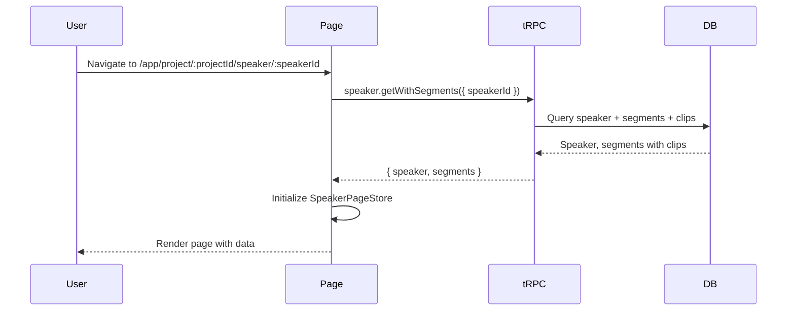
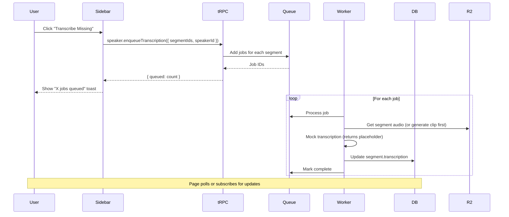
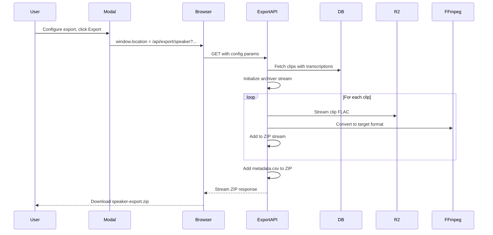

# Design: Speaker Page

## Overview

The speaker page provides a dedicated view for managing all segments belonging to a specific speaker across all clipping sessions. It displays segment/clip pairs with transcriptions, enables batch processing operations (transcription, denoise, overlap removal) via BullMQ queues, and supports streaming ZIP export in LJSpeech format. This phase implements the UI, data layer, and service interfaces with mock implementations; actual third-party integrations are deferred.

## Architecture



**Audio Source Clarification**:
- **Segments**: Fetch from `/api/media-proxy?storageKey=X&startMs=Y&endMs=Z` → create blob object URL → attach to `<audio>` element
- **Clips**: Request pre-signed URL via `speaker.getClipPresignedUrl` → cache with expiration → use directly as `<audio src>`

## Components

### Speaker Page Route

**Purpose**: Container page for speaker segment management
**Location**: `src/app/(app)/app/project/[projectId]/speaker/[speakerId]/page.tsx`

**Responsibilities**:
- Fetch speaker and segments data via tRPC
- Initialize SpeakerPageStore with fetched data
- Render layout with header, list, and sidebar
- Handle 404 when speaker not found

### SpeakerPageStore (Legend-State)

**Purpose**: Client-side state management for the speaker page
**Location**: `src/features/speaker/store/speaker-store.ts`

**Responsibilities**:
- Hold speaker info, segments, and clips data
- Manage filter state (duration range, MOS score, transcription status)
- Track selected segments for batch operations
- Compute filtered segments and statistics
- Handle optimistic updates for transcription edits

**Interfaces**:
```typescript
interface SpeakerPageStoreState {
  // Core data
  speakerId: string;
  projectId: string;
  speaker: Speaker;
  segments: SegmentWithClip[];

  // Filter state
  filters: {
    durationMin: number | null;
    durationMax: number | null;
    mosMin: number | null;
    mosMax: number | null;
    transcriptionStatus: 'all' | 'has' | 'missing';
  };

  // Selection state
  selectedSegmentIds: Set<string>;

  // Computed
  filteredSegments: () => SegmentWithClip[];
  statistics: () => SpeakerStatistics;

  // Actions
  setFilter: (key: keyof Filters, value: unknown) => void;
  clearFilters: () => void;
  toggleSegmentSelection: (segmentId: string) => void;
  selectAll: () => void;
  clearSelection: () => void;
  updateTranscription: (segmentId: string, text: string) => void;
}

interface SegmentWithClip {
  id: string;
  sessionId: string;
  speakerId: string;
  startTime: number;
  endTime: number;
  transcription: string | null;
  clip: Clip | null;
  session: { fileStorageKey: string }; // For media-proxy
}

interface Clip {
  id: string;
  segmentId: string;
  storageKey: string;
  duration: number;
  mosScore: number | null;
  isDenoised: boolean;
  hasOverlapRemoved: boolean;
}

interface SpeakerStatistics {
  totalSegments: number;
  totalDuration: number;
  averageMos: number | null;
  mosDistribution: HistogramData;
  durationDistribution: HistogramData;
  transcriptionCoverage: number; // percentage
}

interface HistogramData {
  buckets: HistogramBucket[];
  min: number;
  max: number;
  bucketSize: number;
}

interface HistogramBucket {
  rangeStart: number;
  rangeEnd: number;
  count: number;
  label: string; // e.g., "1.0-1.5" or "2.5s-3.0s"
}
```

### Speaker Header

**Purpose**: Page header with navigation and export action
**Location**: `src/features/speaker/components/speaker-header.tsx`

**Responsibilities**:
- Display speaker name
- Back button to project page
- Export button that opens export modal

**Interfaces**:
```typescript
interface SpeakerHeaderProps {
  speakerName: string;
  projectId: string;
  onExportClick: () => void;
}
```

### Segment List

**Purpose**: Scrollable list of segment/clip pairs with transcriptions
**Location**: `src/features/speaker/components/segment-list.tsx`

**Responsibilities**:
- Render list header with filter controls and active filter count badge
- Render filtered segments with virtualization (if needed)
- Display segment unit cards
- Handle segment selection
- Show loading states for audio

**Interfaces**:
```typescript
interface SegmentListProps {
  segments: SegmentWithClip[];
  selectedIds: Set<string>;
  onToggleSelect: (id: string) => void;
  activeFilterCount: number;
}
```

### Segment Unit Card

**Purpose**: Single unit displaying segment, clip, and transcription
**Location**: `src/features/speaker/components/segment-unit-card.tsx`

**Responsibilities**:
- Display segment audio player (lazy load via media-proxy)
- Display clip audio player (if exists)
- Show transcription with inline editing
- Display duration, MOS score, processing badges
- Handle delete clip action

**Interfaces**:
```typescript
interface SegmentUnitCardProps {
  segment: SegmentWithClip;
  isSelected: boolean;
  onToggleSelect: () => void;
  onDeleteClip: (clipId: string) => void;
  onTranscriptionChange: (text: string) => void;
}
```

### Segment Audio Player

**Purpose**: Lazy-loading audio player for segments using media-proxy blob URLs
**Location**: `src/features/speaker/components/segment-audio-player.tsx`

**Responsibilities**:
- On first play, fetch audio slice from media-proxy endpoint
- Create blob object URL from response for native audio player
- Show loading spinner during fetch
- Revoke blob URL on unmount to prevent memory leaks
- Display duration

**Audio Source Flow**:
1. User clicks play → fetch `/api/media-proxy?storageKey=X&startMs=Y&endMs=Z`
2. Media-proxy streams audio slice from R2 via FFmpeg
3. Client receives blob → `URL.createObjectURL(blob)`
4. Set blob URL as audio `src`

**Interfaces**:
```typescript
interface SegmentAudioPlayerProps {
  storageKey: string;
  startMs: number;
  endMs: number;
  label: string;
}
```

### Clip Audio Player

**Purpose**: Lazy-loading audio player for clips using pre-signed R2 URLs
**Location**: `src/features/speaker/components/clip-audio-player.tsx`

**Responsibilities**:
- On first play, request pre-signed URL from tRPC endpoint
- Cache pre-signed URL with expiration awareness (re-fetch if expired)
- Set pre-signed URL directly as audio `src` (no blob needed)
- Show loading spinner during URL fetch
- Display MOS score badge if present

**Audio Source Flow**:
1. User clicks play → call `speaker.getClipPresignedUrl({ clipId })`
2. Server generates pre-signed R2 URL (15 min expiration)
3. Client caches URL with expiration timestamp
4. Set pre-signed URL as audio `src`
5. On subsequent plays, check if cached URL expired → re-fetch if needed

**Interfaces**:
```typescript
interface ClipAudioPlayerProps {
  clipId: string;
  storageKey: string;
  mosScore: number | null;
  isDenoised: boolean;
  hasOverlapRemoved: boolean;
}

// Cached URL state (per clip)
interface CachedPresignedUrl {
  url: string;
  expiresAt: number; // Unix timestamp
}
```

### Filter Controls

**Purpose**: Filter UI in list header
**Location**: `src/features/speaker/components/filter-controls.tsx`

**Responsibilities**:
- Duration range sliders (min/max seconds)
- MOS score range sliders (1-5)
- Transcription status radio (all/has/missing)
- Clear filters button
- Active filter count display

**Interfaces**:
```typescript
interface FilterControlsProps {
  filters: Filters;
  onFilterChange: (key: keyof Filters, value: unknown) => void;
  onClearFilters: () => void;
  activeCount: number;
}
```

### Speaker Sidebar

**Purpose**: Statistics and processing actions sidebar
**Location**: `src/features/speaker/components/speaker-sidebar.tsx`

**Responsibilities**:
- Display speaker statistics section
- Display processing actions section
- Display queue status section

### Statistics Section

**Purpose**: Display aggregate speaker statistics
**Location**: `src/features/speaker/components/statistics-section.tsx`

**Responsibilities**:
- Total segment count
- Total duration (formatted)
- Average MOS score
- MOS distribution histogram (10 fixed buckets, dynamic range based on min/max scores)
- Duration distribution histogram (10 fixed buckets, dynamic range based on shortest/longest segments)
- Transcription coverage percentage

**Histogram Implementation**:
- Fixed 10 buckets for consistent visual layout
- Range calculated dynamically: `bucketSize = (max - min) / 10`
- Each bucket labeled with its range (e.g., "1.0-1.5", "2.5s-3.0s")
- Empty buckets displayed as zero-height bars

### Processing Actions Section

**Purpose**: Batch processing action buttons
**Location**: `src/features/speaker/components/processing-actions.tsx`

**Responsibilities**:
- Transcribe button (transcribe selected/all missing)
- Denoise button (denoise selected)
- Remove overlap button (process selected)
- Trigger queue jobs via tRPC mutations
- Disable when no selection or no valid targets

**Interfaces**:
```typescript
interface ProcessingActionsProps {
  selectedCount: number;
  missingTranscriptionCount: number;
  onTranscribe: (scope: 'selected' | 'missing') => void;
  onDenoise: () => void;
  onRemoveOverlap: () => void;
}
```

### Queue Status Section

**Purpose**: Display pending/active job counts
**Location**: `src/features/speaker/components/queue-status.tsx`

**Responsibilities**:
- Poll queue status via tRPC query
- Display counts by job type
- Show processing indicator when jobs active

### Export Modal

**Purpose**: Configure and trigger dataset export
**Location**: `src/features/speaker/components/export-modal.tsx`

**Responsibilities**:
- Audio format selection (WAV, FLAC, MP3)
- Sample rate selection
- Bit depth selection (for WAV)
- Mono/stereo selection
- LJSpeech preset button
- Export progress indicator
- Trigger streaming download

**Interfaces**:
```typescript
interface ExportConfig {
  format: 'wav' | 'flac' | 'mp3';
  sampleRate: 8000 | 16000 | 22050 | 44100 | 48000;
  bitDepth: 16 | 24; // WAV only
  channels: 1 | 2;
}

const LJ_SPEECH_PRESET: ExportConfig = {
  format: 'wav',
  sampleRate: 22050,
  bitDepth: 16,
  channels: 1,
};
```

### Inline Transcription Editor

**Purpose**: Edit transcription text inline
**Location**: `src/features/speaker/components/transcription-editor.tsx`

**Responsibilities**:
- Display transcription text or empty state
- Toggle to edit mode on click
- Save/cancel buttons
- Character count display
- Optimistic update on save

**Interfaces**:
```typescript
interface TranscriptionEditorProps {
  text: string | null;
  onChange: (text: string) => void;
}
```

## Data Flow

### Page Load



### Transcription Trigger



### Export Flow



## Technical Decisions

| Decision | Options Considered | Choice | Rationale |
|----------|-------------------|--------|-----------|
| Transcription storage | Separate table, Column on segments | Column on segments | Simpler queries, 1:1 relationship, no joins needed per requirements |
| Clip-segment relationship | 1:many with history, 1:1 latest only | 1:1 with unique constraint | Requirements specify no clip history; simpler model |
| Export streaming | Store in R2 then redirect, Stream directly | Stream directly | No storage cost, immediate download, follows archiver research |
| Audio player loading | Eager load all, Lazy load on play | Lazy on play | Memory efficiency for large segment counts |
| Filter application | Server-side, Client-side | Client-side | All segments fetched at once (no pagination), faster UX |
| Processing queue | Single queue multi-type, Separate queues | Separate queues | Cleaner job isolation, easier monitoring, follows waveform pattern |
| Service interfaces | Direct implementation, Effect Context.Tag | Effect Context.Tag | Matches existing diarization/storage service patterns |
| State management | React Query only, Legend-State | Legend-State + tRPC | Follows clipping feature pattern, enables optimistic updates |

## File Structure

| File | Action | Purpose |
|------|--------|---------|
| `src/server/db/schema.ts` | Modify | Add transcription column to segments, add clips table |
| `drizzle/XXXX_add_clips_table.sql` | Create | Migration for schema changes |
| `src/server/api/routers/speaker.ts` | Create | tRPC router for speaker page operations |
| `src/server/api/root.ts` | Modify | Register speaker router |
| `src/services/transcription/transcription-service.ts` | Create | TranscriptionService interface + mock |
| `src/services/denoise/denoise-service.ts` | Create | DenoiseService interface + mock |
| `src/services/overlap/overlap-removal-service.ts` | Create | OverlapRemovalService interface + mock |
| `src/services/clip/clip-generation-service.ts` | Create | ClipGenerationService interface + mock |
| `src/services/queue/queue-service.ts` | Modify | Add processing queue methods |
| `src/services/queue/bullmq-queue-service.ts` | Modify | Implement processing queue methods |
| `src/services/index.ts` | Modify | Export new services |
| `workers/processing-worker.ts` | Create | BullMQ worker for clip processing |
| `workers/transcription-worker.ts` | Create | BullMQ worker for transcription |
| `src/app/(app)/app/project/[projectId]/speaker/[speakerId]/page.tsx` | Create | Speaker page route |
| `src/app/(app)/app/project/[projectId]/speaker/[speakerId]/loading.tsx` | Create | Loading state |
| `src/app/(app)/app/project/[projectId]/speaker/[speakerId]/not-found.tsx` | Create | 404 state |
| `src/app/api/export/speaker/route.ts` | Create | Streaming ZIP export endpoint |
| `src/features/speaker/store/speaker-store.ts` | Create | Legend-State store |
| `src/features/speaker/context/store.context.tsx` | Create | Store provider and hook |
| `src/features/speaker/components/speaker-header.tsx` | Create | Page header component |
| `src/features/speaker/components/segment-list.tsx` | Create | Segment list component |
| `src/features/speaker/components/segment-unit-card.tsx` | Create | Segment/clip/transcription card |
| `src/features/speaker/components/segment-audio-player.tsx` | Create | Segment audio player |
| `src/features/speaker/components/clip-audio-player.tsx` | Create | Clip audio player |
| `src/features/speaker/components/filter-controls.tsx` | Create | Filter UI |
| `src/features/speaker/components/speaker-sidebar.tsx` | Create | Sidebar container |
| `src/features/speaker/components/statistics-section.tsx` | Create | Statistics display |
| `src/features/speaker/components/processing-actions.tsx` | Create | Processing buttons |
| `src/features/speaker/components/queue-status.tsx` | Create | Queue status display |
| `src/features/speaker/components/export-modal.tsx` | Create | Export configuration modal |
| `src/features/speaker/components/transcription-editor.tsx` | Create | Inline transcription editor |
| `src/features/speaker/components/index.ts` | Create | Component exports |
| `src/app/(app)/app/project/[projectId]/page.tsx` | Modify | Add link to speaker page from speaker cards |
| `src/lib/export/stream-zip.ts` | Create | ZIP streaming utilities |
| `src/lib/export/ffmpeg-convert.ts` | Create | FFmpeg format conversion utilities |
| `src/features/speaker/utils/histogram.ts` | Create | Histogram calculation utility (10 fixed buckets, dynamic range) |

## Database Schema Changes

### Add transcription to segments

```typescript
// In segments table definition
transcription: text("transcription"), // Nullable TEXT column
```

### New clips table

```typescript
export const clipStatus = pgEnum("clip_status", [
  "pending",
  "processing",
  "completed",
  "failed",
]);

export const clips = pgTable(
  "clip",
  {
    id: uuid("id").defaultRandom().primaryKey(),
    segmentId: uuid("segment_id")
      .notNull()
      .references(() => segments.id, { onDelete: "cascade" })
      .unique(), // 1:1 relationship enforced

    // Storage
    storageKey: varchar("storage_key", { length: 1024 }),
    duration: doublePrecision("duration"),

    // Processing state
    status: clipStatus("status").default("pending"),
    errorMessage: text("error_message"),

    // Quality (manual annotation)
    mosScore: doublePrecision("mos_score"),

    // Processing flags
    isDenoised: boolean("is_denoised").default(false),
    hasOverlapRemoved: boolean("has_overlap_removed").default(false),

    createdAt: timestamp("created_at", { withTimezone: true })
      .defaultNow()
      .notNull(),
    updatedAt: timestamp("updated_at", { withTimezone: true })
      .defaultNow()
      .notNull()
      .$onUpdate(() => new Date()),
  },
  (table) => [
    index("clip_segment_id_idx").on(table.segmentId),
    index("clip_status_idx").on(table.status),
  ],
);

// Relations
export const clipRelations = relations(clips, ({ one }) => ({
  segment: one(segments, {
    fields: [clips.segmentId],
    references: [segments.id],
  }),
}));

// Update segment relations
export const segmentRelations = relations(segments, ({ one }) => ({
  session: one(clippingSessions, { ... }),
  speaker: one(speakers, { ... }),
  clip: one(clips), // Add clip relation
}));
```

## Service Interfaces

### TranscriptionService

```typescript
// src/services/transcription/transcription-service.ts
import { Context, Data, type Effect } from "effect";

export interface TranscribeParams {
  audioBuffer: Buffer;
  format: string;
  language?: string;
}

export interface TranscribeResult {
  text: string;
  confidence?: number;
  durationMs: number;
}

export class TranscriptionService extends Context.Tag("TranscriptionService")<
  TranscriptionService,
  {
    readonly transcribe: (
      params: TranscribeParams,
    ) => Effect.Effect<TranscribeResult, TranscriptionError>;
  }
>() {}

export class TranscriptionError extends Data.TaggedError("TranscriptionError")<{
  message: string;
  cause?: unknown;
}> {}

// Mock implementation
export const MockTranscriptionServiceLive = Layer.succeed(
  TranscriptionService,
  TranscriptionService.of({
    transcribe: (params) =>
      Effect.succeed({
        text: "[Mock transcription - replace with actual service]",
        confidence: 0.95,
        durationMs: params.audioBuffer.length / 100, // Fake duration
      }),
  }),
);
```

### DenoiseService

```typescript
// src/services/denoise/denoise-service.ts
import { Context, Data, type Effect } from "effect";

export interface DenoiseParams {
  audioBuffer: Buffer;
  format: string;
  strength?: number; // 0-1
}

export interface DenoiseResult {
  audioBuffer: Buffer;
  format: string;
}

export class DenoiseService extends Context.Tag("DenoiseService")<
  DenoiseService,
  {
    readonly denoise: (
      params: DenoiseParams,
    ) => Effect.Effect<DenoiseResult, DenoiseError>;
  }
>() {}

export class DenoiseError extends Data.TaggedError("DenoiseError")<{
  message: string;
  cause?: unknown;
}> {}

// Mock implementation - returns input unchanged
export const MockDenoiseServiceLive = Layer.succeed(
  DenoiseService,
  DenoiseService.of({
    denoise: (params) =>
      Effect.succeed({
        audioBuffer: params.audioBuffer,
        format: params.format,
      }),
  }),
);
```

### OverlapRemovalService

```typescript
// src/services/overlap/overlap-removal-service.ts
import { Context, Data, type Effect } from "effect";

export interface OverlapRemovalParams {
  audioBuffer: Buffer;
  format: string;
}

export interface OverlapRemovalResult {
  audioBuffer: Buffer;
  format: string;
  removedDurationMs: number;
}

export class OverlapRemovalService extends Context.Tag("OverlapRemovalService")<
  OverlapRemovalService,
  {
    readonly removeOverlap: (
      params: OverlapRemovalParams,
    ) => Effect.Effect<OverlapRemovalResult, OverlapRemovalError>;
  }
>() {}

export class OverlapRemovalError extends Data.TaggedError("OverlapRemovalError")<{
  message: string;
  cause?: unknown;
}> {}

// Mock implementation - returns input unchanged
export const MockOverlapRemovalServiceLive = Layer.succeed(
  OverlapRemovalService,
  OverlapRemovalService.of({
    removeOverlap: (params) =>
      Effect.succeed({
        audioBuffer: params.audioBuffer,
        format: params.format,
        removedDurationMs: 0,
      }),
  }),
);
```

### ClipGenerationService

```typescript
// src/services/clip/clip-generation-service.ts
import { Context, Data, type Effect } from "effect";

export interface GenerateClipParams {
  sourceStorageKey: string;
  startMs: number;
  endMs: number;
  outputFormat: 'flac';
}

export interface GenerateClipResult {
  audioBuffer: Buffer;
  format: string;
  durationMs: number;
}

export class ClipGenerationService extends Context.Tag("ClipGenerationService")<
  ClipGenerationService,
  {
    readonly generateClip: (
      params: GenerateClipParams,
    ) => Effect.Effect<GenerateClipResult, ClipGenerationError>;
  }
>() {}

export class ClipGenerationError extends Data.TaggedError("ClipGenerationError")<{
  message: string;
  cause?: unknown;
}> {}

// Real implementation using FFmpeg
export const FFmpegClipGenerationServiceLive = Layer.succeed(
  ClipGenerationService,
  ClipGenerationService.of({
    generateClip: (params) =>
      Effect.tryPromise({
        try: async () => {
          // Implementation uses FFmpeg to slice audio
          // Similar to stream-audio.ts but outputs to buffer
        },
        catch: (error) =>
          new ClipGenerationError({
            message: "Failed to generate clip",
            cause: error,
          }),
      }),
  }),
);
```

## Queue Job Types

```typescript
// src/services/queue/queue-service.ts (additions)

export interface ClipProcessingJobPayload {
  segmentId: string;
  operations: ('generate' | 'denoise' | 'overlap')[];
}

export interface TranscriptionJobPayload {
  segmentId: string;
  clipStorageKey?: string; // If clip exists, use it; else generate
}

export interface ClipProcessingEnqueueResult {
  segmentId: string;
  jobId: string;
  position: number;
}

export interface TranscriptionEnqueueResult {
  segmentId: string;
  jobId: string;
  position: number;
}

// Extended QueueService interface
export class QueueService extends Context.Tag("QueueService")<
  QueueService,
  {
    // Existing
    readonly enqueueWaveformGeneration: ...;
    readonly getWaveformPosition: ...;

    // New
    readonly enqueueClipProcessing: (
      payload: ClipProcessingJobPayload,
    ) => Effect.Effect<ClipProcessingEnqueueResult, QueueEnqueueError>;

    readonly enqueueTranscription: (
      payload: TranscriptionJobPayload,
    ) => Effect.Effect<TranscriptionEnqueueResult, QueueEnqueueError>;

    readonly getProcessingQueueStatus: () => Effect.Effect<{
      clipProcessing: { waiting: number; active: number };
      transcription: { waiting: number; active: number };
    }, QueueStatusError>;
  }
>() {}
```

## tRPC Router

```typescript
// src/server/api/routers/speaker.ts

export const speakerRouter = createTRPCRouter({
  // Get speaker with all segments and clips
  getWithSegments: protectedProcedure
    .input(z.object({ speakerId: z.string().uuid() }))
    .query(async ({ ctx, input }) => {
      // Returns speaker + segments + clips + session info for media-proxy
    }),

  // Update segment transcription
  updateTranscription: protectedProcedure
    .input(z.object({
      segmentId: z.string().uuid(),
      transcription: z.string().max(10000),
    }))
    .mutation(async ({ ctx, input }) => {
      // Update segment.transcription
    }),

  // Enqueue transcription jobs
  enqueueTranscription: protectedProcedure
    .input(z.object({
      segmentIds: z.array(z.string().uuid()),
    }))
    .mutation(async ({ ctx, input }) => {
      // Queue transcription jobs via QueueService
    }),

  // Enqueue clip processing (denoise, overlap removal)
  enqueueProcessing: protectedProcedure
    .input(z.object({
      segmentIds: z.array(z.string().uuid()),
      operations: z.array(z.enum(['denoise', 'overlap'])),
    }))
    .mutation(async ({ ctx, input }) => {
      // Queue processing jobs via QueueService
    }),

  // Delete clip (reset processing)
  deleteClip: protectedProcedure
    .input(z.object({ clipId: z.string().uuid() }))
    .mutation(async ({ ctx, input }) => {
      // Delete from R2 and database
    }),

  // Get queue status
  getQueueStatus: protectedProcedure
    .query(async ({ ctx }) => {
      // Return processing queue counts
    }),

  // Update clip MOS score
  updateMosScore: protectedProcedure
    .input(z.object({
      clipId: z.string().uuid(),
      mosScore: z.number().min(1).max(5),
    }))
    .mutation(async ({ ctx, input }) => {
      // Update clip.mosScore
    }),

  // Get pre-signed URL for clip audio playback
  getClipPresignedUrl: protectedProcedure
    .input(z.object({ clipId: z.string().uuid() }))
    .query(async ({ ctx, input }) => {
      // Verify ownership, generate pre-signed URL with 15 min expiration
      // Returns: { url: string, expiresAt: number }
    }),
});
```

## Error Handling

| Error Scenario | Handling Strategy | User Impact |
|----------------|-------------------|-------------|
| Speaker not found | Return 404 page | Shows "Speaker not found" with back link |
| Segment fetch fails | tRPC error, show error state | Shows error message with retry button |
| Audio load fails | Catch in player, show error icon | Player shows error state, can retry |
| Transcription job fails | Mark job failed, show in queue status | Toast notification, can retry from UI |
| Processing job fails | Mark clip status failed, store error | Shows error badge on clip, can delete and retry |
| Export fails mid-stream | Browser shows download error | User can retry export |
| Queue service unavailable | tRPC error on enqueue | Toast error, disable processing buttons temporarily |
| R2 storage error | Service layer error | Toast error, operation fails gracefully |
| Invalid filter values | Client-side validation | Prevent invalid input, show validation message |

## Edge Cases

- **Empty speaker**: Speaker has no segments. Show empty state with message explaining segments come from clipping sessions.
- **All segments filtered out**: Filters exclude all segments. Show "No segments match filters" with clear filters button.
- **Clip without transcription**: Valid state, clip can exist without transcription. Export includes only clips WITH transcriptions.
- **Segment without clip**: Valid state, segment not yet processed. Show "No clip" indicator, prompt to generate.
- **Long transcription**: Display truncated with expand button. Full text shown in edit mode.
- **Processing in progress**: Show processing indicator on segment. Disable delete until complete.
- **Large export**: Many clips to export. Streaming handles this; show progress indicator.
- **Concurrent edits**: Optimistic update with tRPC retry. Last write wins for transcription.
- **Queue backlog**: Many jobs queued. Show queue position, processing time estimate.
- **Pre-signed URL expired**: Client checks expiration before play, re-fetches if expired. Cache stores `expiresAt` timestamp.
- **All MOS scores identical**: Histogram shows single bucket with all items. Min=Max handled gracefully.
- **Single segment**: Histogram shows meaningful single-bucket visualization. No division by zero.

## Test Strategy

### Unit Tests

**Store logic** (`src/features/speaker/store/__tests__/speaker-store.test.ts`):
- Filter computation (duration, MOS, transcription status)
- Statistics calculation (total, average, distributions)
- Selection state management
- Optimistic update application

**Histogram utility** (`src/features/speaker/utils/__tests__/histogram.test.ts`):
- Computes 10 buckets with correct ranges
- Handles edge cases (single value, all same values, empty array)
- Generates correct labels for MOS (1.0-1.5) and duration (2.5s-3.0s)

**Service interfaces**:
- Mock implementations return expected results
- Error cases propagate correctly

### Integration Tests

**tRPC router** (`src/server/api/routers/__tests__/speaker.test.ts`):
- `getWithSegments` returns correct data structure
- `updateTranscription` updates database
- `enqueueTranscription` creates queue jobs
- `deleteClip` removes from R2 and database
- `getClipPresignedUrl` returns URL with valid expiration

**Export endpoint** (`src/app/api/export/speaker/__tests__/route.test.ts`):
- Generates valid ZIP structure
- Converts audio to target format
- Creates correct metadata.csv
- Respects filter parameters

### Component Tests (Storybook)

**SegmentUnitCard**:
- Renders segment without clip
- Renders segment with clip
- Renders transcription editor
- Handles loading states

**ClipAudioPlayer**:
- Fetches pre-signed URL on first play
- Uses cached URL on subsequent plays
- Re-fetches when cached URL expired
- Shows loading spinner during fetch

**FilterControls**:
- Slider interactions
- Radio selection
- Clear filters action

**ExportModal**:
- Preset selection
- Manual configuration
- Export trigger

### E2E Tests (Playwright)

**Speaker page flow**:
- Navigate to speaker page from project
- Apply filters and verify list updates
- Edit transcription inline
- Trigger processing action
- Export with LJSpeech preset

## Performance Considerations

- **Virtual scrolling**: If segment count exceeds 100, implement virtualization using `@tanstack/react-virtual` (already in dependencies)
- **Audio lazy loading**: Only load audio when user clicks play, not on page load
- **Filter debouncing**: Debounce slider inputs to prevent excessive recomputation
- **Statistics memoization**: Cache computed statistics, recompute only when segments change
- **Export streaming**: No memory accumulation, stream directly to response
- **Queue polling**: Poll queue status at 5s intervals, not continuously
- **Index optimization**: Ensure database indexes on speakerId, segmentId for efficient queries

## Security Considerations

- **Authorization**: All tRPC procedures verify user owns the speaker (via project ownership check)
- **Export authorization**: Verify user owns speaker before allowing export
- **Storage key validation**: Media-proxy validates user ID in storage key path
- **Input validation**: All tRPC inputs validated with Zod schemas
- **File path traversal**: Export generates safe filenames, no user-controlled paths
- **Rate limiting**: Queue service has rate limiting (follows waveform pattern)

## Existing Patterns to Follow

Based on codebase analysis:

1. **Effect.js services**: Use `Context.Tag` pattern for service interfaces (see `diarization-service.ts`, `storage-service.ts`)
2. **BullMQ workers**: Follow `waveform-worker.ts` structure for new workers
3. **Legend-State stores**: Follow `clipping-store.ts` pattern with slices and computed values
4. **tRPC routers**: Follow `clipping-session.ts` pattern for protected procedures
5. **Page structure**: Follow clipping session page pattern with store provider
6. **Header component**: Follow `OuterHeader` pattern for back button + title + action
7. **Sidebar component**: Follow `RightSidebar` pattern for contextual actions
8. **Audio streaming**: Follow `stream-audio.ts` for FFmpeg piping patterns
9. **Error classes**: Use `Data.TaggedError` for typed errors in Effect.js
